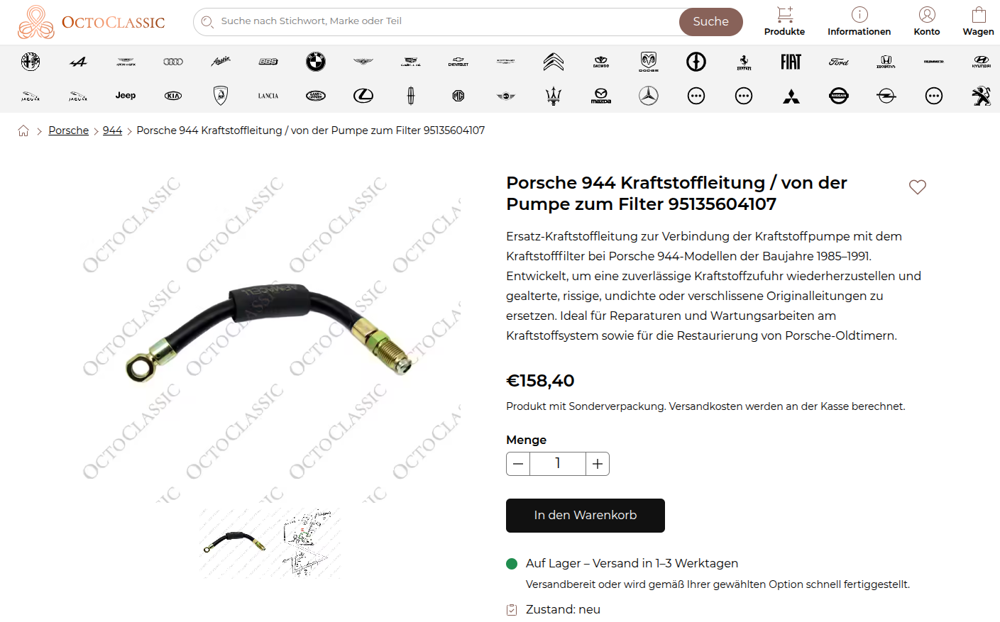
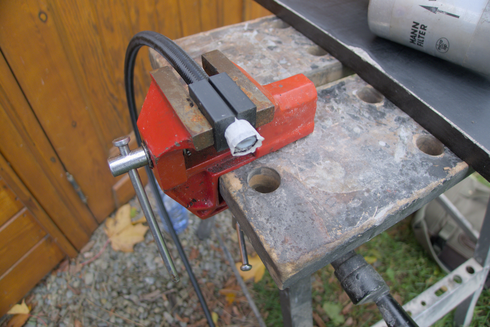
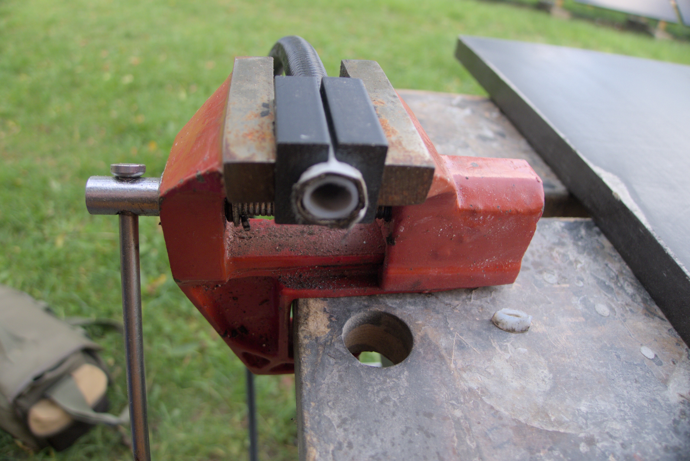

+++
date = '2026-10-24T14:31:15+02:00'
draft = false
title = 'New Fuel Line for Porsche'
+++

The fuel line on my Porsche 944 that runs between the fuel pump and filter needs to be replaced, and the new part from Porsche is overpriced.

# Parts

Another Porsche 944 owner posted an interesting article on how he replaced all the fuel lines on his car with a 6AN system. An overview of the process and the parts he used can be found on his website under [deancent.com/porsche-944-fuel-line-build-and-install/](https://www.deancent.com/porsche-944-fuel-line-build-and-install/).

Though not extremely cheap, the parts needed for the replacement fuel line using 6AN parts are much cheaper than the Porsche part. I got these parts from the european supplier [speedingparts.eu](https://www.speedingparts.eu/).

| Art. No | Name | Quantity | Price | Sum |
| :--- | :--- | :--- | :--- | :--- |
| 02A612b | Banjo connection AN6-M12 | 1 pcs | 10,56 | 10,56 |
| SPDABM12 | Aluminum Washer M12 | 3 pcs | 0,96 | 2,88 |
| SPDPTFENY6 | AN6 nylon braided PTFE hose | 1 m | 19,52 | 19,52 |
| 3060665Db | AN6 - M16x1,50 Adapter | 1 pcs | 6,08 | 6,08 |
| SPDABM16 | Aluminum Washer M16 | 2 pcs | 1,20 | 2,40 |
| 804606PTFEb | AN6 hose end 45 ° PTFE (Black-Black) | 1 pcs | 17,04 | 17,04 |
| 800106PTFEb | AN6 hose end straight PTFE (Black-Black) | 1 pcs | 6,96 | 6,96 |
 
# Assembly

I'm using the same technique as [deancent](https://www.deancent.com/porsche-944-fuel-line-build-and-install/) for measuring the length of tube needed by simply putting it next to the old tube, and I'm also cutting the tube to length using an angle grinder. This causes the nylon to fuse somewhat together and avoids fraying. 

# Conclusion

The process of cutting the tube using an angle grinder and cutoff disc was quite straightforward, but tightening the AN6 fittings onto the PTFE hose was more challenging than I thought and required a lot of force. I was unable to fully tighten one end as the amount of force needed was damaging the aluminum pieces. One thing to remember for next time is to buy the simple AN6 hose ends instead of the integrated ones that make a corner (like I got the 45° hose end), as the simple ones are much cheaper and messing up a hose just means getting two new hose ends and trying again. Nothing can go wrong when screwing the AN6 adapters on, but making the hoses seems to not be as fool proof. I will test the host to see if it holds up. It looks good, and the reason for being unable to tighten the thread as far as I expected might be that the steel braid is in the way.

